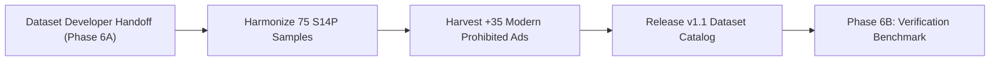

# SAFE-VISION — Phase 6A: Dataset Developer Formal Handoff Specification

**Document Reference**: `PHASE_6A_DATASET_DEVELOPER_HANDOFF.md`  
**Date**: 2026-10-22  
**Target Repository**: `QuadRos-MBCET/safead-dataset-hub`  
**Governing Specification**: [`docs/DATA_CONTRACT_SPECIFICATION.md`](file:///c:/Users/hello/Downloads/Project%20main%20Instagram/docs/DATA_CONTRACT_SPECIFICATION.md)  
**Accompanying Manifest**: [`docs/SAFE_14_PLUS_LABEL_REVIEW_MANIFEST.csv`](file:///c:/Users/hello/Downloads/Project%20main%20Instagram/docs/SAFE_14_PLUS_LABEL_REVIEW_MANIFEST.csv)  

---

## 1. Context & Objectives

The full 194-sample clean development benchmark evaluation (Phase 5B) confirmed that automatic advertisement approval cannot be deployed due to two fundamental dataset-level barriers:
1. **Annotator Concept Drift in `SAFE_14_PLUS`**: 48 of 75 samples labeled `14+` are standard commercial products (streetwear, gaming gear, automobiles, slot cars) that contain zero safety hazards. Safety moderation models approve them for all audiences (`SAFE_FOR_ALL`), driving a false 62.39% Underage Gating Violation Rate.
2. **Prohibited Category Scarcity & Domain Shift in `UNSAFE_FOR_ALL`**: Only 10 genuine prohibited ads exist in the clean development set (7 images, 3 videos). The 7 images are 1880s degraded patent-medicine print clippings. Modern digital deceptive advertisements were almost entirely confined to the 118 synthetic review cards ($800 \times 520$ images with labels printed on them) that had to be excluded due to label leakage.

This handoff outlines the concrete requirements for publishing **SafeAd Dataset Hub v1.1**.

---

## 2. Action Items for Dataset Developer

### Action Item 1: Harmonize `SAFE_14_PLUS` Ground Truth
- **Action**: Review all 75 development samples in [`docs/SAFE_14_PLUS_LABEL_REVIEW_MANIFEST.csv`](file:///c:/Users/hello/Downloads/Project%20main%20Instagram/docs/SAFE_14_PLUS_LABEL_REVIEW_MANIFEST.csv).
- **Rule**: Distinguish **demographic target audience appeal** (e.g. teen streetwear, gaming mice, muscle cars) from **safety harm gating** (e.g. mild combat violence, PG-13 horror themes, suggestive apparel).
- **Relabeling Directive**:
  - Reclassify general consumer goods with 0.0 safety hazard as `SAFE_FOR_ALL`.
  - Reclassify suggestive attire / beachwear / swimwear as `SAFE_18_PLUS` or retain as `SAFE_14_PLUS` only with an explicit written policy rationale defining the permissible threshold.

### Action Item 2: Fulfill Prohibited Expansion Quota (+35 Modern Digital Ads)
- **Action**: Ingest +35 modern clean digital prohibited advertisement creatives into the development split.
- **Priority Formats**:
  1. Social media sponsored display ads promoting cryptocurrency giveaway scams / doubler schemes.
  2. Phishing display ads with URL shortener links (`tinyurl`, `bit.ly`) and prize claims.
  3. Online sponsored advertorials for unverified miracle cures and prohibited weight loss supplements.
  4. Display ads for prohibited weapons or illegal knife retailing.
- **Strict Anti-Leakage Standard**: Zero synthetic review borders, zero `800x520` cards, and zero answer-revealing text overlays.

### Action Item 3: Clean Test Split Partitioning
- **Action**: The current held-out test split (`splits/repaired_benchmark/test_held_out.csv`, $N=96$) contains 28 synthetic review cards.
- **Directive**: Quarantine the 28 synthetic cards and mirror the clean proportion in the test split without touching or exposing test media to the engineering team.

---

## 3. Delivery Schedule & Gate Criteria

### Verification Gate Before Phase 6B:
- [ ] Catalog schema conforms to all 18 columns in [`DATA_CONTRACT_SPECIFICATION.md`](file:///c:/Users/hello/Downloads/Project%20main%20Instagram/docs/DATA_CONTRACT_SPECIFICATION.md).
- [ ] SHA-256 hash verified for 100% of media files.
- [ ] Zero synthetic review card templates ($800 \times 520$) in development or test splits.
- [ ] Zero ground-truth leakage in OCR text transcripts.
